# Proyecto 3 — Mejorando algoritmos con CUDA
**Informe de Rendimiento y Análisis** · CC3069 Computación Paralela y Distribuida · UVG · Semestre II 2026

Integrantes: Roberto Nájera, Genser Catalán, Estuardo Castro · Repositorio: <https://github.com/Ultimate-Truth-Seeker/Proyecto3CPyD>

## Resumen
Se aceleró el clasificador ASL del Laboratorio 3 de Data Science (CNN 2, 29 clases, imágenes 64×64×3, 20 300 imágenes) separando el trabajo en dos recursos: **la preparación de imágenes (leer JPG, redimensionar, normalizar) se reparte entre los núcleos del CPU**, y **el entrenamiento y la inferencia de la red se ejecutan en el GPU con CUDA**. Medido en Google Colab (Tesla T4, 2 vCPU):

- **Entrenamiento (4 épocas): 692 s → 31.5 s, speedup 22.0×** (época en régimen estable: 176 s → 3.7 s, 47.6×).
- **Preparación de imágenes: 23.5 s → 20.3 s, speedup 1.2×** — modesto porque el Colab gratuito expone 2 vCPU que son **un solo núcleo físico con 2 hilos**.
- **Extremo a extremo (preparar + entrenar + inferir): 724 s → 55 s, speedup 13.2×.** Tras acelerar el entrenamiento, la preparación en CPU pasa de ser el 3 % del tiempo a ser el 37 %: el cuello de botella se desplaza.
- **Entrenando hasta converger** (protocolo del Lab 3) el GPU alcanza 93.7–95.9 % de exactitud en test (Lab 3: 95.7 %) en 46–63 s; en CPU el mismo entrenamiento tomaría ≈ 32–44 min (estimado).
- La utilización del GPU fue baja (media 23 %): con una red pequeña y batch de 32, el GPU queda subutilizado.

## 1. Entorno y metodología

| Elemento | Valor |
|---|---|
| GPU | NVIDIA Tesla T4, 15 360 MiB, driver 580.82.07 (CUDA 13.0); TensorFlow compilado con CUDA 12.5.1 y cuDNN 9 |
| CPU | Intel Xeon @ 2.00 GHz, **2 vCPU = 1 núcleo físico × 2 hilos** (`lscpu`), 13.6 GB RAM |
| Software | Python 3.13, TensorFlow 2.21.0, Keras 3.13.2 |
| Datos | ASL Alphabet (Kaggle); 700 imágenes/clase → 20 300; split estratificado 70/15/15 = 14 210 / 3 045 / 3 045; semilla 42 |
| Modelo | CNN 2 del Lab 3 (3×[Conv+BatchNorm+MaxPool], Dense 256, Dense 128, softmax 29), Adam, lr 5·10⁻⁴ |
| Condiciones | **4 épocas fijas** (sin `EarlyStopping`) para que CPU y GPU hagan exactamente el mismo trabajo; batch 32; 3 repeticiones; warm-up sin medir; mismos datos y semilla |

**Procedimiento.** (1) El manifiesto y el split se construyen una sola vez, de modo que secuencial y paralelo procesan las mismas 20 300 rutas. (2) Se hace una *lectura en frío* de todos los archivos para dejarlos en el caché del sistema operativo; así las repeticiones comparan cómputo y no el disco de Colab. (3) Cada fase se repite 3 veces y se reporta promedio ± desviación estándar. (4) La versión paralela de la preparación se verifica **idéntica bit a bit** a la secuencial (`np.array_equal`). (5) En GPU, los arreglos NumPy se pasan directo a `fit()`, por lo que el tiempo **incluye las transferencias host→device** de cada batch. (6) Un hilo en segundo plano registra cada 1 s el uso de cada vCPU, la utilización y memoria del GPU (`nvidia-smi`) y la RAM; su costo es el mismo en todas las fases.

## 2. Análisis de la solución secuencial (Paso 1)
La tubería del Lab 3 es: *descarga/validación del dataset → manifiesto con submuestra → split estratificado → leer, decodificar, redimensionar y normalizar cada imagen → construir tensores → entrenar → evaluar*. Las tablas completas de operaciones (Tabla 1) y de operaciones repetitivas (Tabla 2) están en la sección 1 del notebook `proyecto3_cuda.ipynb`. Los dos bucles pesados son:

| Operación repetitiva | Datos que procesa | Repeticiones |
|---|---|---|
| Leer + decodificar + redimensionar + normalizar | 1 imagen JPG 200×200×3 (independiente de las demás) | 20 300 |
| Paso de entrenamiento (adelante, pérdida, atrás, Adam) | 1 mini-batch de 32 imágenes 64×64×3 | 445 por época × 4 épocas |
| Evaluación de validación / test | lotes de 32 imágenes | 96 lotes por época / 96 lotes |

## 3. Paralelización y diseño (Pasos 3 y 4)
| Operación | Dónde | Justificación |
|---|---|---|
| Leer, decodificar, redimensionar y normalizar cada imagen | **CPU, procesos** (`multiprocessing`, contexto `spawn`, `chunksize=64`) | 20 300 tareas independientes; la decodificación JPEG (Huffman) es un flujo de bits con ramas y acceso a archivos: no encaja en el modelo SIMT del GPU. |
| Convoluciones, BatchNorm, pooling, multiplicaciones matriciales, retropropagación, Adam | **GPU (CUDA: cuDNN y cuBLAS)** | Operaciones regulares, densas, de alta intensidad aritmética, con millones de elementos independientes. |
| Bucle de mini-batches y épocas | secuencial | El paso *k+1* necesita los pesos del paso *k* (límite de Amdahl). |

**Mapeo CUDA.** Un hilo calcula un elemento del tensor de salida; un bloque, un *tile* del tensor de salida; el grid cubre `batch × alto × ancho × filtros`. Las 32 imágenes del batch se procesan a la vez (primera dimensión del grid). Se implementó además un kernel propio para `Dense 4608→256 + ReLU` con bloque de 16×16 hilos y grid `⌈256/16⌉ × ⌈M/16⌉` (sección 5.4).

## 4. Resultados de rendimiento (Pasos 2, 5 y 6)

### 4.1 Preparación de imágenes (Fase A), en segundos
| Ejecución | Secuencial, 1 proceso (s) | Paralelo, 2 procesos (s) |
|---|---|---|
| 1 | 23.14 | 20.40 |
| 2 | 23.46 | 20.29 |
| 3 | 23.96 | 20.14 |
| **Promedio ± σ** | **23.52 ± 0.34** | **20.28 ± 0.11** |

Escalamiento con el número de procesos (1 repetición por punto):

| Procesos | Tiempo (s) | Speedup vs. secuencial |
|---|---|---|
| 1 | 23.92 | 0.98 |
| 2 | 20.22 | 1.16 |
| 4 | 19.28 | 1.22 |
| 8 | 21.55 | 1.09 |

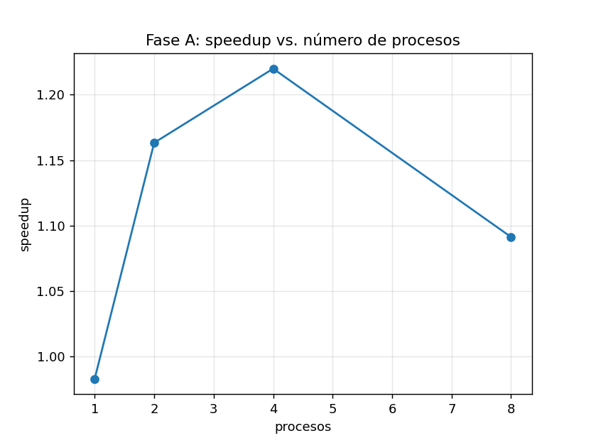

El speedup se estanca en ≈ 1.2× porque las 2 vCPU de Colab son **un solo núcleo físico con hyper-threading**: dos procesos comparten las mismas unidades de ejecución y, con 4 u 8 procesos, solo se añade cambio de contexto. La eficiencia con 2 procesos es 0.58. En una máquina con más núcleos físicos se esperaría un escalamiento mucho mayor.

### 4.2 Entrenamiento e inferencia (Fases B y C)
Resumen (promedio de 3 ejecuciones):

| Configuración | fit 4 épocas (s) | época estable (s) | 1.ª época (s) | inferencia test (s) | acc. test (media) |
|---|---|---|---|---|---|
| CPU (secuencial, bs=32) | 692.2 ± 38.2 | 175.85 | 163.7 | 8.23 ± 1.95 | 71.8 % |
| GPU CUDA (bs=32) | 31.5 ± 5.4 | 3.69 | 18.9 | 3.19 ± 1.66 | 68.6 % |
| GPU CUDA optimizado (bs=128, fp16) | 26.8 ± 4.2 | 1.75 | 20.0 | 2.49 ± 0.69 | 20.6 % |

Detalle por ejecución:

| Configuración | Ejec. | fit 4 épocas (s) | 1.ª época (s) | época estable (s) | inferencia (s) | acc. test |
|---|---|---|---|---|---|---|
| CPU (secuencial, bs=32) | 1 | 649.1 | 159.8 | 162.8 | 10.5 | 71.8 % |
| CPU (secuencial, bs=32) | 2 | 722.2 | 166.5 | 185.0 | 6.8 | 71.8 % |
| CPU (secuencial, bs=32) | 3 | 705.3 | 165.0 | 179.8 | 7.4 | 71.8 % |
| GPU (CUDA, bs=32) | 1 | 37.7 | 24.9 | 3.71 | 4.97 | 65.9 % |
| GPU (CUDA, bs=32) | 2 | 28.3 | 15.7 | 3.73 | 1.70 | 69.1 % |
| GPU (CUDA, bs=32) | 3 | 28.5 | 16.0 | 3.65 | 2.90 | 70.9 % |
| GPU optimizado (CUDA, bs=128, fp16) | 1 | 31.6 | 24.8 | 1.76 | 3.29 | 20.6 % |
| GPU optimizado (CUDA, bs=128, fp16) | 2 | 24.2 | 17.4 | 1.72 | 2.10 | 20.6 % |
| GPU optimizado (CUDA, bs=128, fp16) | 3 | 24.5 | 17.7 | 1.76 | 2.07 | 20.6 % |

### 4.3 Tabla comparativa y speedup por fase
| Fase | Secuencial (s) | GPU bs=32 (s) | Speedup bs=32 | GPU bs=128+fp16 (s) | Speedup bs=128+fp16 |
|---|---|---|---|---|---|
| A. Preparación de imágenes (1 → 2 procesos en CPU) | 23.52 | 20.28 | 1.2× | 20.28 | 1.2× |
| B. Entrenamiento, 4 épocas (CPU → GPU) | 692.2 | 31.5 | 22.0× | 26.8 | 25.8× |
| B′. Época en régimen estable (CPU → GPU) | 175.8 | 3.69 | 47.6× | 1.75 | 100.7× |
| C. Inferencia sobre test (CPU → GPU) | 8.23 | 3.19 | 2.6× | 2.49 | 3.3× |
| **Extremo a extremo A+B+C** | **723.9** | **55.0** | **13.2×** | **49.5** | **14.6×** |

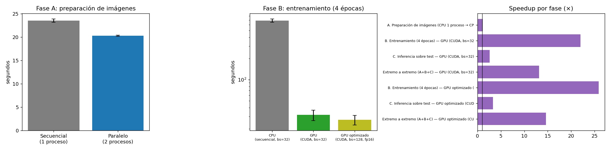

Notas para interpretar la tabla:

- **La 1.ª época en GPU cuesta ≈ 19 s frente a 3.7 s de las siguientes**: inicialización de cuDNN, selección de algoritmos y trazado del grafo. Con solo 4 épocas ese costo fijo pesa mucho (por eso B′ muestra 47.6× y B 22.0×); con más épocas el speedup global se acerca al de la época estable.
- **La inferencia mejora poco (2.6×).** Son solo 3 045 imágenes y el tiempo está dominado por costos fijos de `predict()` (construcción del grafo, conversión de datos), no por cómputo; además tiene alta variabilidad (σ = 1.66 s).
- La comparación bs=128+fp16 **cambia también el tamaño de batch**; su speedup de época (100.7×) mezcla el efecto del GPU con el de procesar 4× más imágenes por paso.
- **Límite de Amdahl.** En la línea base la preparación es el 3.2 % del tiempo. Si el entrenamiento y la inferencia fueran gratis, el speedup máximo sin acelerar la fase A sería 31×; el observado (13.2×) queda por debajo por la inicialización del GPU y la fase A.
- **Variabilidad.** La primera ejecución en GPU fue más lenta (37.7 s vs. ≈ 28 s); Colab es una máquina compartida y la T4 operaba a 74 °C.

## 5. Evidencia de ejecución y análisis

### 5.1 Uso de recursos medido
| Fase | CPU medio (%) | CPU por vCPU (%) | GPU util. media / p90 / máx (%) | Memoria GPU máx. (MB) |
|---|---|---|---|---|
| A secuencial (1 proceso) | 62 | 64 / 59 | 0 / 0 / 0 | 3 |
| A paralela (2 procesos) | 98 | 98 / 98 | 0 / 0 / 0 | 105 |
| B entrenamiento CPU | 87 | 87 / 87 | 0 / 0 / 0 | 105 |
| B entrenamiento GPU (bs=32) | 59 | 57 / 62 | 23 / 63 / 93 | 2213 |
| B entrenamiento GPU (bs=128, fp16) | 64 | 65 / 64 | 14 / 60 / 69 | 2229 |

| Fase | Gráfica |
|---|---|
| Preparación secuencial | 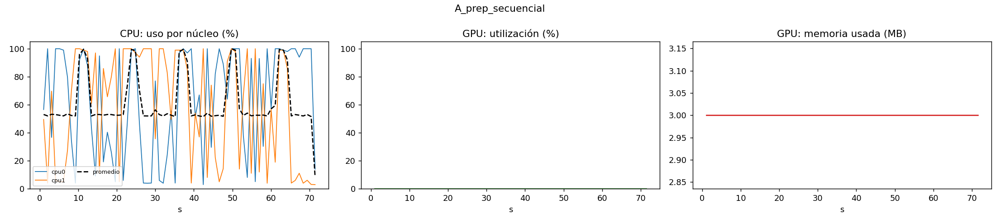 |
| Preparación paralela | 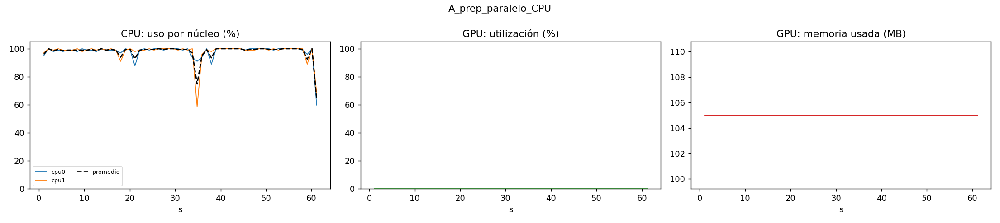 |
| Entrenamiento en CPU | 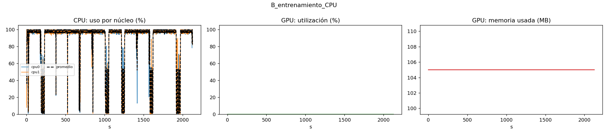 |
| Entrenamiento en GPU (bs=32) | 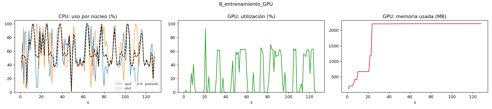 |
| Entrenamiento en GPU (bs=128, fp16) | 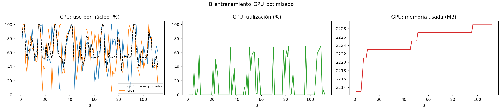 |

Lectura: en la preparación **secuencial** el CPU promedia 62 % (un solo proceso Python); en la **paralela** ambas vCPU están al 98 %. En el **entrenamiento en CPU** ambas vCPU trabajan al 87 % y el GPU permanece en 0 %. En el **entrenamiento en GPU** el entorno reconoce y usa la T4: se asignan ≈ 2213 MB de memoria de GPU y la utilización llega a 93 % con una media de solo 23 %.

**El GPU no está saturado.** La gráfica muestra un patrón de picos (≈ 60 %) intercalados con valles en 0 %, que tienden a coincidir con picos del CPU al 100 %. Es consistente con que el CPU prepara cada batch desde NumPy, lanza los kernels y ejecuta la validación mientras el GPU espera (no se aisló cada causa con un perfilador). Con un modelo pequeño y batches de 32 imágenes de 64×64, cada kernel dura microsegundos y el costo de lanzamiento y de Python/TensorFlow por paso es comparable al cómputo. En la variante bs=128+fp16 la época baja a 1.75 s (≈ 2.1× más rápida que bs=32) pero la utilización media del GPU **baja** a 14 %: el cuello de botella ya no es el cómputo sino la alimentación de datos y el lanzamiento de kernels.

*Nota sobre los logs de `nvidia-smi`:* las capturas `results/nvidia_smi_durante_entrenamiento_*.txt` se tomaron al inicio de la 2.ª época, instante en que el GPU estaba entre épocas (0 % de utilización, pero 2.2 GB asignados y el proceso `python3` visible en la tabla de procesos). La utilización real durante el entrenamiento está en las series de `results/uso_B_entrenamiento_GPU*.csv`.

### 5.1b Capturas de pantalla del entorno (Colab)
Capturas del cuaderno junto al panel *Recursos* de Colab durante la ejecución:

| Captura | Qué muestra |
|---|---|
| 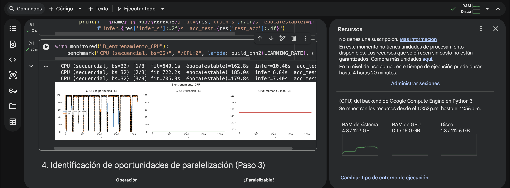 | Entrenamiento en **CPU** (celda 9, 35 min): la gráfica del monitor muestra ambas vCPU saturadas y GPU en 0 %; el panel marca **RAM de GPU 0.1 / 15.0 GB** (sin uso). |
| 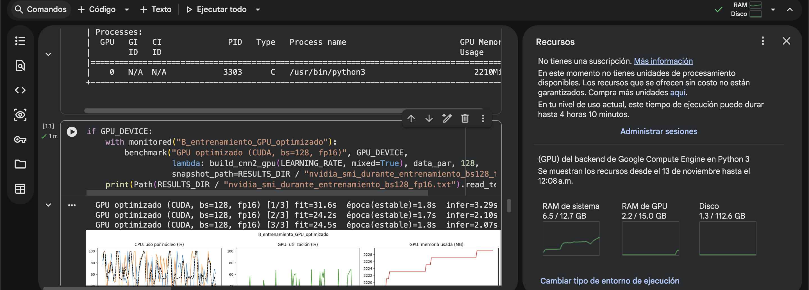 | Entrenamiento en **GPU** (celda 13): `nvidia-smi` lista el proceso `python3` con ≈ 2210 MiB y el panel marca **RAM de GPU 2.2 / 15.0 GB**. |
| 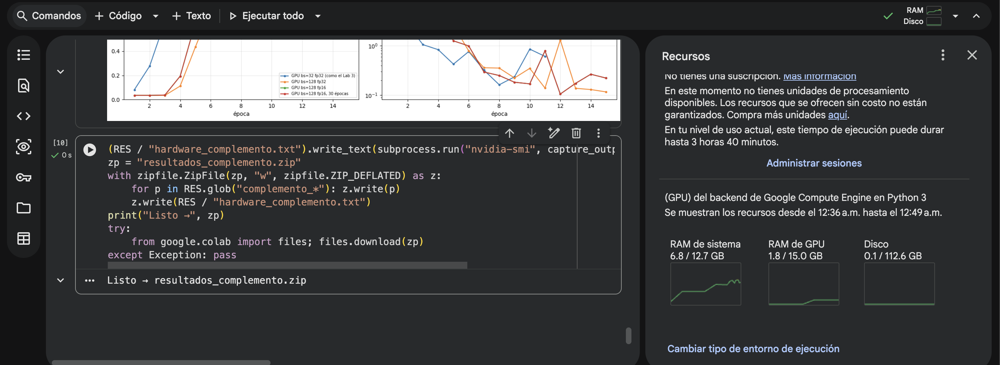 | Notebook complementario al terminar el entrenamiento hasta convergencia (curvas de validación de las 4 configuraciones) con **RAM de GPU 1.8 / 15.0 GB**. |

### 5.2 Equivalencia de resultados y convergencia
Con 4 épocas fijas la exactitud en test es: CPU 71.8 %, GPU bs=32 68.6 % (rango 65.9–70.9 %), GPU bs=128+fp16 20.6 %. **Estas cifras no representan la calidad final del modelo**: el Lab 3 entrenó hasta 15 épocas con `EarlyStopping` y obtuvo 95.7 %; aquí el entrenamiento se corta a propósito a las 4 épocas para medir tiempo con trabajo idéntico, y con BatchNorm la exactitud oscila bastante entre épocas. La diferencia CPU/GPU está dentro de esa variabilidad (el CPU es determinista; el GPU varía entre ejecuciones por el no determinismo de los kernels y el orden de las operaciones de punto flotante). La variante bs=128+fp16 hace 4× menos actualizaciones por época (112 vs. 445) con el mismo learning rate, por lo que a las 4 épocas está claramente sub-entrenada: **sus tiempos no son comparables en calidad**.

Entrenamiento hasta convergencia en GPU (protocolo del Lab 3: máx. 15 épocas, `EarlyStopping`):

| Configuración | Épocas (mejor) | fit (s) | Época estable (s) | Acc. val. máx. | Acc. test | CPU estimado (s) | Speedup est. |
|---|---|---|---|---|---|---|---|
| GPU bs=32 fp32 (como el Lab 3) | 11 (8) | 62.6 | 3.71 | 94.5 % | 93.7 % | 1934 | 30.9× |
| GPU bs=128 fp32 | 15 (15) | 54.7 | 2.40 | 96.5 % | 95.9 % | 2638 | 48.2× |
| GPU bs=128 fp16 | 15 (12) | 53.2 | 1.74 | 96.3 % | 95.5 % | 2638 | 49.6× |
| GPU bs=128 fp16, 30 épocas | 15 (12) | 45.6 | 1.74 | 96.3 % | 95.5 % | 2638 | 57.8× |

*«CPU estimado» = épocas ejecutadas × 175.8 s (época estable medida en CPU); es una extrapolación, no una medición.*

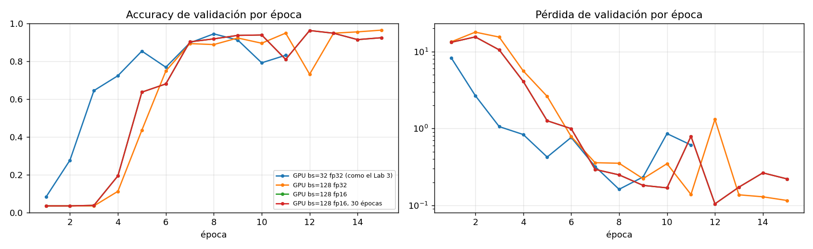

**Lectura.** Entrenando hasta converger, el GPU alcanza **93.7–95.9 % de exactitud en test**, en línea con el 95.7 % que obtuvo la CNN 2 en el Lab 3: el GPU acelera el cálculo sin cambiar lo que aprende la red. Con el protocolo del Lab 3 (bs=32) el entrenamiento terminó en 11 épocas (63 s en GPU frente a ≈ 32 min estimados en CPU, 31×); `EarlyStopping` lo detuvo temprano por las oscilaciones de la pérdida de validación que provoca BatchNorm (visibles en la gráfica). **Con 4 épocas la exactitud de la corrida principal (≈ 69-72 %) era simplemente sub-entrenamiento.** Con batch 128 la red llega a 95.9 % (fp32) y 95.5 % (fp16): la precisión mixta casi no cambia el resultado (0.4 puntos menos) y acelera la época de 2.40 s a 1.74 s. La 4.ª fila (30 épocas máx.) se detuvo también en la época 15 con los mismos pesos que la 3.ª (misma semilla), por lo que es redundante en exactitud; sus tiempos distintos (45.6 s vs. 53.2 s para el mismo entrenamiento) muestran la variabilidad de tiempo de Colab entre ejecuciones idénticas (≈ 14 %).

### 5.3 Costo de la transferencia CPU ↔ GPU
Copia de 0.70 GB (tamaño del conjunto de entrenamiento en `float32`), con sincronización explícita:

| Medición | Tiempo (ms) | Ancho de banda (GB/s) |
|---|---|---|
| Host→GPU (memoria paginada) | 152.0 ± 1.3 | 4.6 |
| Host→GPU (memoria pinned) | 56.6 ± 0.0 | 12.3 |
| GPU→Host (memoria paginada) | 254.0 ± 5.2 | 2.7 |

La copia completa del conjunto de entrenamiento cuesta ≈ 0.15 s, es decir ≈ 0.5 % del `fit` de 4 épocas en GPU (bs=32), y se paga una vez por época si los datos se envían por batch. Es chica frente al cómputo, pero no nula. La memoria *pinned* es 2.7× más rápida que la paginada y alcanza ≈ 12.3 GB/s, cerca del máximo teórico del PCIe 3.0 ×16; traer datos de vuelta al *host* es más lento (2.7 GB/s), motivo para mantener los resultados en el GPU hasta el final y mover solo lo necesario. Como `fit()` envía los datos desde NumPy (memoria paginada), usar `tf.data` con `prefetch` o datos residentes en GPU sería una mejora posible.

### 5.4 Kernel CUDA propio (`Dense 4608→256 + ReLU`, M = 3 045)
| Implementación | Tiempo (ms) | Speedup vs. NumPy | Correcto |
|---|---|---|---|
| NumPy (CPU, 1 hilo BLAS compartido) | 181.555 | 1.0× | ✓ |
| Numba naive | 71.794 | 2.5× | ✓ |
| Numba tiled (memoria compartida) | 72.288 | 2.5× | ✓ |
| CUDA C naive (CuPy/NVRTC) | 20.833 | 8.7× | ✓ |
| CUDA C tiled (CuPy/NVRTC) | 9.490 | 19.1× | ✓ |
| cuBLAS (cupy matmul + ReLU) | 1.143 | 158.9× | ✓ |

Los kernels de Numba y los de CUDA C producen el mismo resultado que NumPy. En CUDA C el kernel con memoria compartida es 2.2× más rápido que el ingenuo (cada dato cargado se reutiliza 16 veces dentro del bloque), y cuBLAS, afinado por NVIDIA, sigue siendo la referencia (8.3× más rápido que el mejor kernel propio).

**Los kernels de Numba resultaron más lentos que los de CUDA C con el mismo diseño (≈ 3.5× el ingenuo y ≈ 7.6× el *tiled*) y el *tiling* no aportó nada** (71.8 ms vs. 72.3 ms). Causa probable, no verificada con un perfilador: en Numba el acumulador se inicializó con `acc = 0.0`, que es `float64`, por lo que el producto-acumulación se hace en doble precisión, y la T4 tiene un rendimiento de `float64` ≈ 1/32 del de `float32`; ese costo aritmético domina y oculta la ventaja de la memoria compartida. La corrección esperada es inicializar con `float32(0.0)`. El NumPy de esta tabla (≈ 182 ms) es más lento que el de la corrida principal (70.7 ms) probablemente porque Colab asignó otra máquina o distinto número de hilos BLAS (no se verificó); por eso los speedups de la tabla son relativos a esta misma corrida.

## 6. Discusión técnica

### 6.1 ¿Por qué es más eficiente procesar las imágenes/archivos con los múltiples núcleos del CPU y delegar exclusivamente la matemática de la red neuronal al GPU?
- **Naturaleza del trabajo.** Decodificar un JPEG es recorrer un flujo de bits con decodificación de Huffman (cada símbolo depende del anterior), con muchas ramas y acceso a archivos. Los hilos de un *warp* ejecutan la misma instrucción a la vez; si cada imagen sigue un camino distinto, se serializan (divergencia). El CPU, con pocos núcleos muy flexibles (predicción de ramas, cachés grandes), maneja bien este patrón, y como cada imagen es independiente se reparte entre procesos sin comunicación.
- **Entrada/salida.** Los archivos viven en el disco/RAM del *host*; el GPU no los lee directamente. Decodificar en GPU (nvJPEG/DALI) es posible, pero con imágenes de 200×200 añade complejidad y el beneficio es pequeño.
- **La matemática de la red es regular:** las mismas operaciones de multiplicar-acumular sobre millones de elementos independientes, sin ramas y con alta reutilización de datos. Es lo que el GPU hace mejor (miles de hilos, memoria compartida, Tensor Cores).
- **Transferencias.** PCIe es mucho más lento que la memoria del GPU. Se preprocesa **una sola vez** en el CPU y solo se mueven tensores compactos y listos para usar.
- **Dónde está el tiempo.** La preparación ocurre una vez (24 s en secuencial, 3 % del total), mientras que el entrenamiento repite 445 pasos por época (692 s en CPU). Delegar la red al GPU recupera casi todo el tiempo; acelerar además la preparación solo importa cuando el entrenamiento ya es rápido (aquí lo es: pasa a ser el 37 % del total).

### 6.2 ¿Cómo CUDA permitió reducir o cambiar el tiempo de procesamiento?
- Una época pasó de **176 s a 3.7 s (47.6×)**: miles de hilos calculan en paralelo los elementos de salida de cada convolución y de cada multiplicación matricial (cuDNN/cuBLAS), mientras el CPU, con un solo núcleo físico, ejecuta esas mismas operaciones con SIMD y poca concurrencia. Entrenar 4 épocas pasó de 11.5 min a 32 s (22.0×); el costo fijo de inicialización del GPU (≈ 15 s en la 1.ª época) se amortiza con más épocas.
- Con el protocolo completo del Lab 3 (hasta converger) el entrenamiento en GPU tarda ≈ 63 s frente a ≈ 32 min estimados en CPU (≈ 31×), con exactitud equivalente.
- **Cambió también el perfil del tiempo:** de 96 % entrenamiento + 3 % preparación a una distribución más repartida (preparación 37 %, entrenamiento 57 %, inferencia 6 %).
- **Ajustes dentro del GPU.** Aumentar el batch a 128 y usar precisión mixta (Tensor Cores) redujo la época a 1.75 s, pero con menor utilización de GPU, lo que confirma que con este modelo pequeño el límite pasó a ser la alimentación de datos y el lanzamiento de kernels, no la capacidad aritmética del GPU.

### 6.3 ¿Qué factores justifican o limitan la utilización de CUDA?
**Justifican:** operaciones densas y regulares; alto paralelismo de datos (batch × píxeles × filtros); alta intensidad aritmética; una carga que se repite cientos de veces (pasos × épocas), lo que amortiza la inicialización y las transferencias.

**Limitan (observados en este experimento):**
1. **Amdahl:** el bucle de pasos/épocas es secuencial y la preparación en CPU no se acelera con el GPU; con el entrenamiento ya rápido, la fase A es el 37 % del total.
2. **Tamaño del problema:** batch de 32 imágenes de 64×64 y una red de pocas capas no saturan una T4 (utilización media 23 %). Con modelos o batches mayores el speedup crecería.
3. **Costos fijos:** inicialización de cuDNN y trazado del grafo (≈ 15 s), y *overhead* de lanzamiento de kernels y de Python/TensorFlow por paso. La inferencia de 3 045 imágenes solo mejora 2.6× por este motivo.
4. **Transferencias PCIe** y memoria del GPU (15 GB en la T4; el entrenamiento usó ≈ 2.2 GB).
5. **Recursos del CPU de Colab:** 1 núcleo físico limita la fase A (speedup 1.2×) y alimenta al GPU con lentitud.
6. **Portabilidad/ecosistema:** versiones de CUDA, cuDNN y nvJitLink deben ser compatibles; en este proyecto Numba falló por esa causa (ver 5.4).

### 6.4 Funciones y librerías adicionales que usan el GPU
CUDA runtime y driver; **cuDNN** (convoluciones, BatchNorm, pooling, selección de algoritmos); **cuBLAS** (GEMM de las capas densas); **TensorFlow/Keras** (`tf.device`, despacho de kernels, `keras.mixed_precision` para FP16 en Tensor Cores); **Numba** (`numba.cuda`: `cuda.jit`, `cuda.shared.array`, `cuda.syncthreads`) y **CuPy** (`RawKernel`, NVRTC) para los kernels propios; **`nvidia-smi`** para monitoreo.

## 7. Limitaciones del estudio
- Un único entorno (Colab gratuito, 1 núcleo físico); con un CPU más potente, el speedup frente al CPU sería menor, y el de la fase A, mayor.
- 4 épocas fijas para medir tiempo, no calidad; la comparación de exactitud se complementa con el entrenamiento hasta convergencia (5.2).
- Speedups de época en régimen estable excluyen la 1.ª época; el speedup de `fit` la incluye.
- El monitor de recursos agrega un costo pequeño y común a todas las fases.

## 8. Conclusiones
1. Separar el trabajo funcionó: **CPU para archivos, GPU para la matemática de la red**. El entrenamiento se aceleró 22.0× (4 épocas) y la época en régimen estable 47.6×; el proceso completo, 13.2×.
2. La preparación en CPU solo ganó 1.2× con 2 procesos porque Colab ofrece un único núcleo físico; el diseño escala con los núcleos disponibles.
3. El GPU quedó subutilizado (≈ 23 %): el límite está en el tamaño del problema y la alimentación de datos, no en la capacidad del hardware. Aumentar el batch o la complejidad del modelo es el siguiente paso natural.
4. El GPU no compromete la calidad: entrenado hasta converger llega a 93.7–95.9 % en test (Lab 3: 95.7 %). El tiempo de transferencia es pequeño con memoria *pinned* (12.3 GB/s) y mayor con memoria paginada.
5. La ganancia depende de amortizar costos fijos (inicialización, transferencias, preparación): conviene en entrenamientos con muchas épocas y no en inferencias cortas.

## 9. Contribuciones
| Integrante | Contribución |
|---|---|
| Roberto Nájera | Análisis del código secuencial, diseño e implementación de la versión paralela (CPU multi-proceso y GPU/CUDA), mediciones en Colab, análisis e informe. |
| Genser Catalán | _(completar)_ |
| Estuardo Castro | _(completar)_ |

## 10. Reproducibilidad
`notebooks/proyecto3_cuda.ipynb` (experimento principal, ejecutado, con salidas) y `notebooks/proyecto3_complemento.ipynb` (kernels, transferencias y convergencia). Datos crudos de las mediciones en `results/`. Este informe se genera con `python docs/build_informe.py .` a partir de esos CSV.
